# KiCAD Prism

[](https://github.com/krishna-swaroop/KiCAD-Prism/releases/latest)
[](https://github.com/krishna-swaroop/KiCAD-Prism/releases)
[](LICENSE)

KiCAD Prism is an open-source, self-hosted review, release and
component-governance platform for teams that design in KiCad and keep their
projects in Git.

KiCad remains the editor and Git remains the source of truth. Prism adds what
happens around them: browsing every revision in the browser, reviewing changes
with comments, building and signing off release packages, and running a governed
component library that desktop KiCad places parts from. It runs on your own
hardware, with no proprietary ECAD cloud.

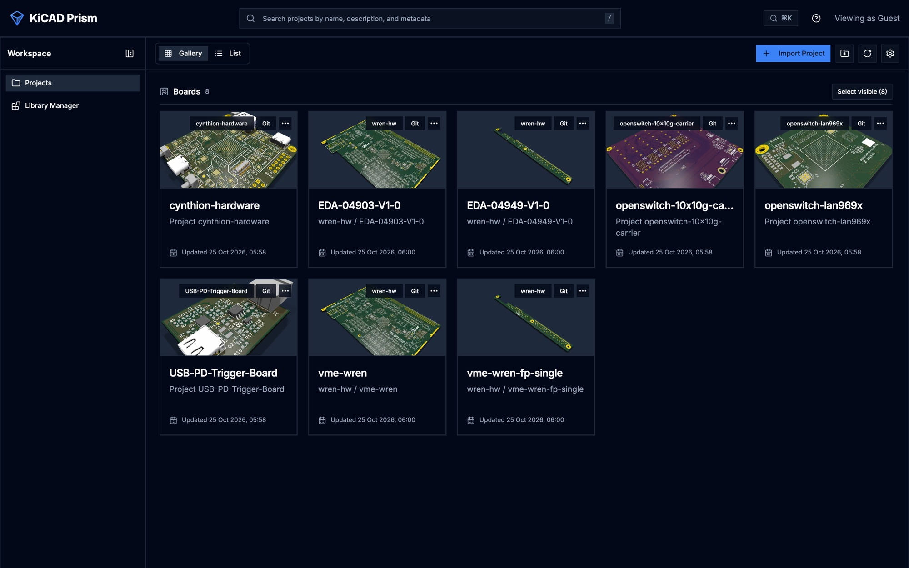

*The designs in these screenshots are third-party hardware projects, used to
show Prism working on real boards. They are not made by Prism. See
[Designs shown in the screenshots](#designs-shown-in-the-screenshots).*

## What Prism does

### Browse and review any revision

Import projects from SSH or HTTPS Git remotes, monorepos included. Every
revision opens in schematic, PCB, 3D, BOM and stackup views, with cross-probing
between them, net highlighting, point-to-point measurement and PCB or schematic
insets. Prism reads each revision once with its own Rust KiCad parser and keeps
the result as a design bundle, so recent commits and every tag open without
waiting.

| Schematic | PCB | 3D |
| --- | --- | --- |
| 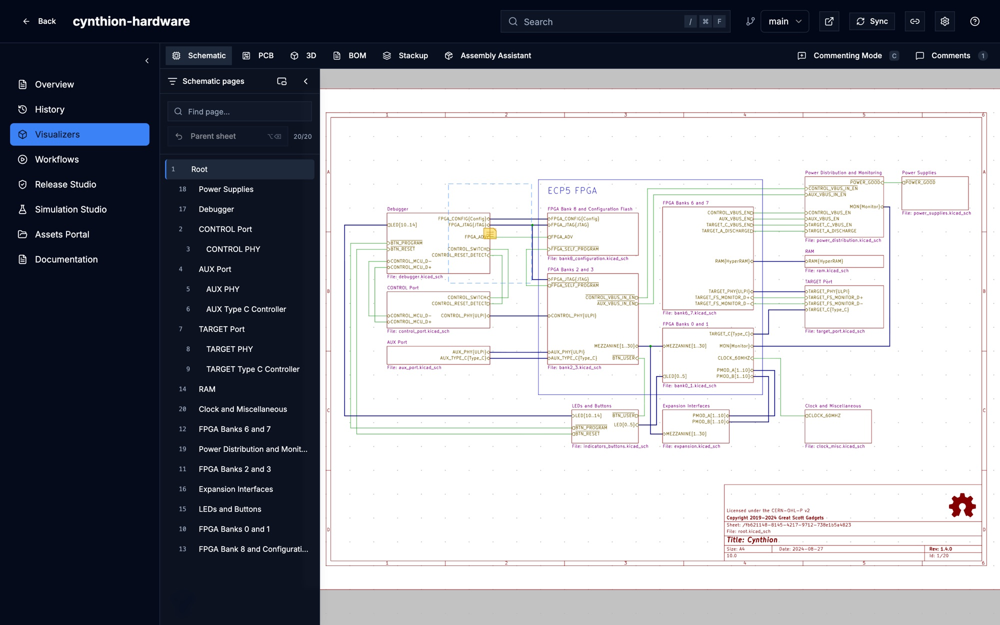 | 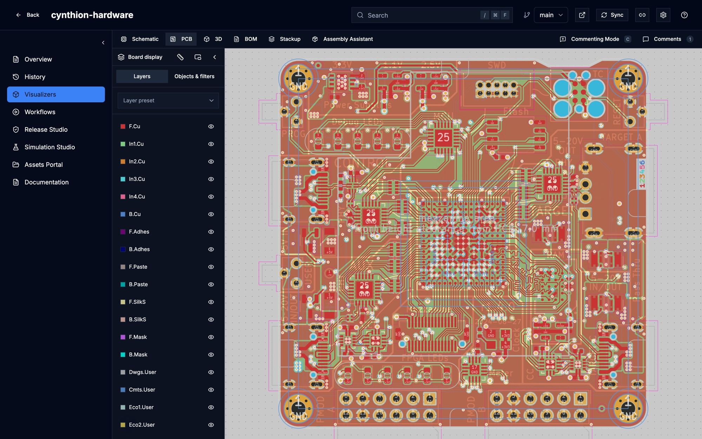 | 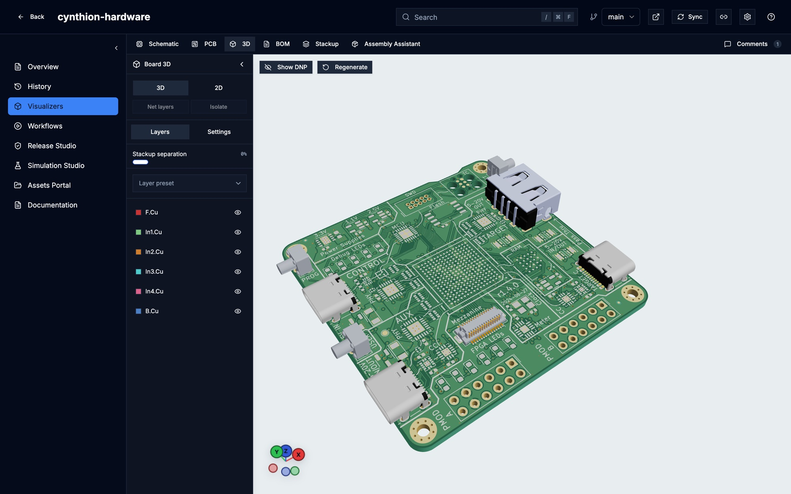 |

Insets open a live view of the other document from any pin or pad, and chain
from there: below, a PCB inset of U1's CC1 pin leads to a schematic inset of C7.

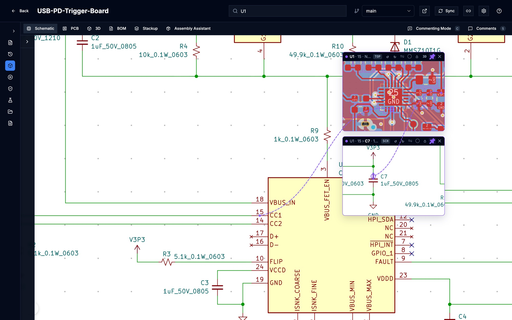

Select a net to highlight it across the schematic, PCB and 3D views, with its
routed length, layers, tracks and vias. In 3D, isolate a net to see only its
copper: tracks, zones, pads and vias.

| Net highlight (PCB) | Net highlight (3D) | Net isolated (3D) |
| --- | --- | --- |
| 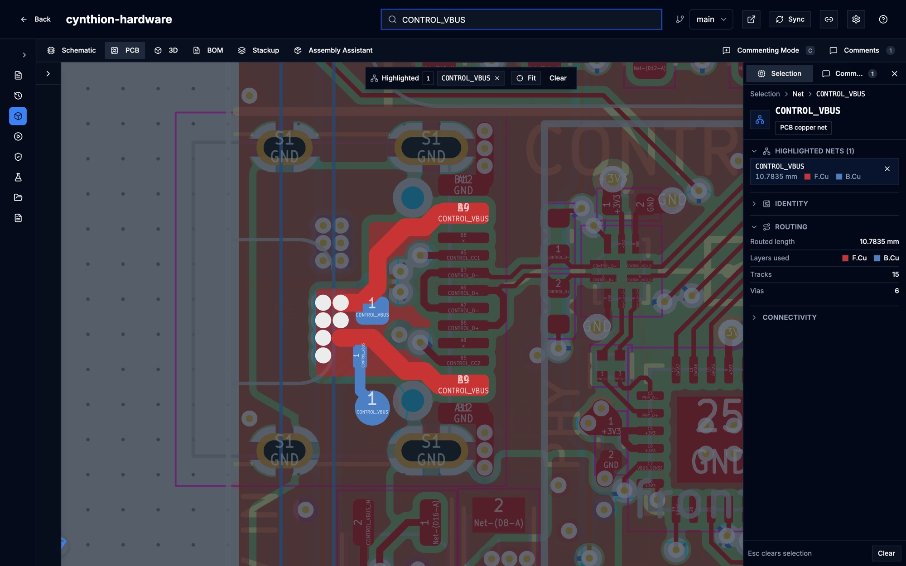 | 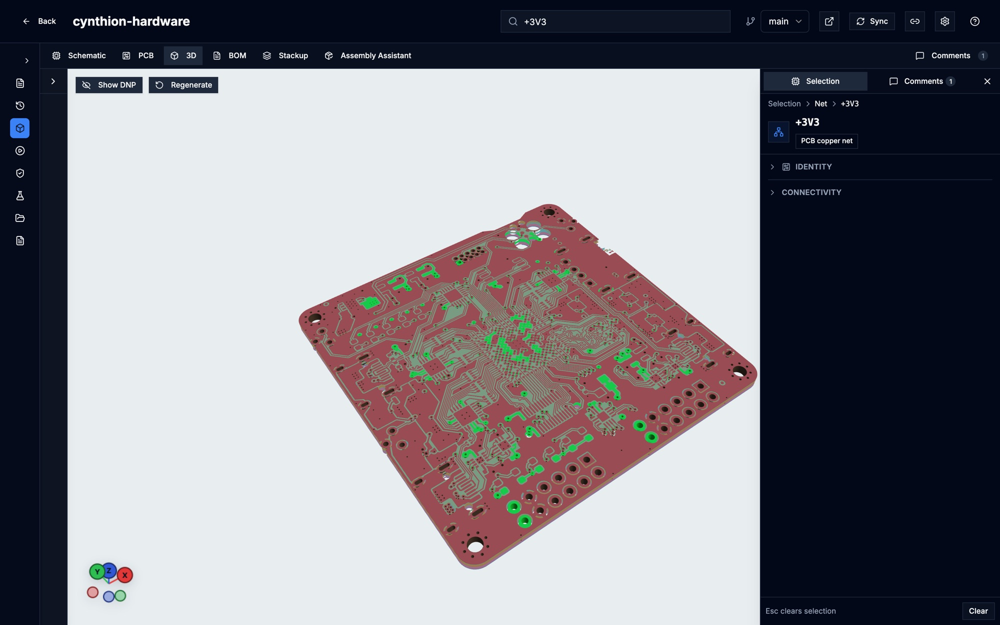 | 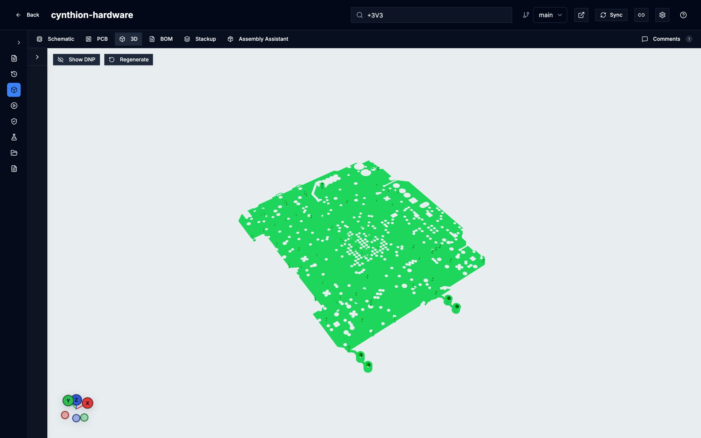 |

Comment on any sheet, part or area. Comments are rich text with pasted snips
and attachments, anchored to the revision they were written on, and can be
published to GitHub or GitLab issues.


### Compare revisions

Compare any two revisions. Design Comparison lists what changed in the
schematic, PCB, BOM, stackup and fabrication outputs, highlights it on the
sheet, and keeps the review discussion next to it.


### Release a board

Release Studio takes a committed revision through source, identity,
manufacturing, build, outputs and publish. It builds fabrication and assembly
files, PDF documents and manufacturer packs, shows the Gerbers in the browser,
records DRC/ERC evidence and designer and QA sign-off, and publishes the
approved package to GitHub or GitLab Releases.

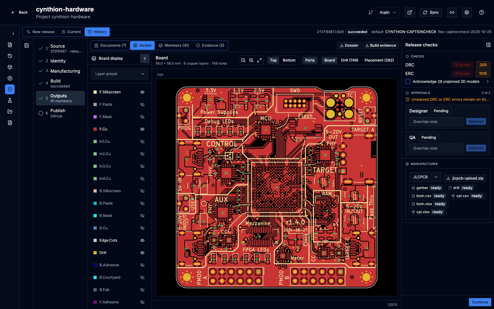

### Govern components

Library Manager is a component catalog with immutable revisions, reusable
symbol, footprint, 3D and SPICE assets, optional KiCad Library Convention
checks and a QA release flow. Components can be imported from library folders
or from the parts your projects already use. Released parts reach desktop KiCad
through the Remote Symbol Provider, which places the exact catalog revision with
its 3D models embedded, or through a generated KiCad database library.

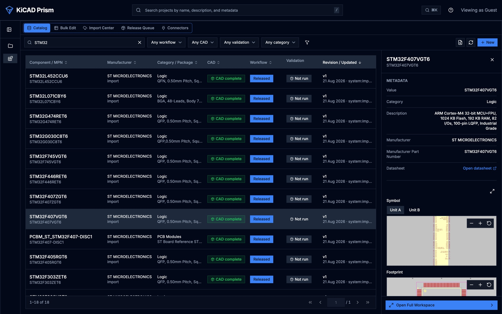

In KiCad, the Remote Symbol Provider panel shows a released part's details and
symbol and footprint previews, and places it.

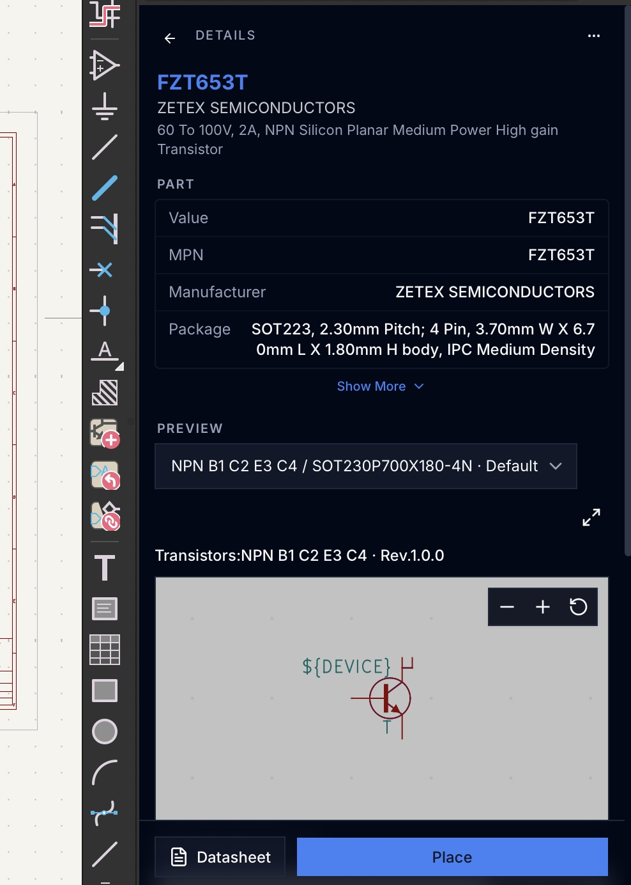

### Document a design

Generated documents are built from the same design bundle. The connector
interface control sheet below, one per connector with views from its STEP model,
a board locator and the pinout with the nets each pin reaches, comes from the
documentation prototypes in [`native/src/rs/prism-docs-lab`](native/src/rs/prism-docs-lab/README.md).
The prototypes are run by hand and are not part of the product yet.

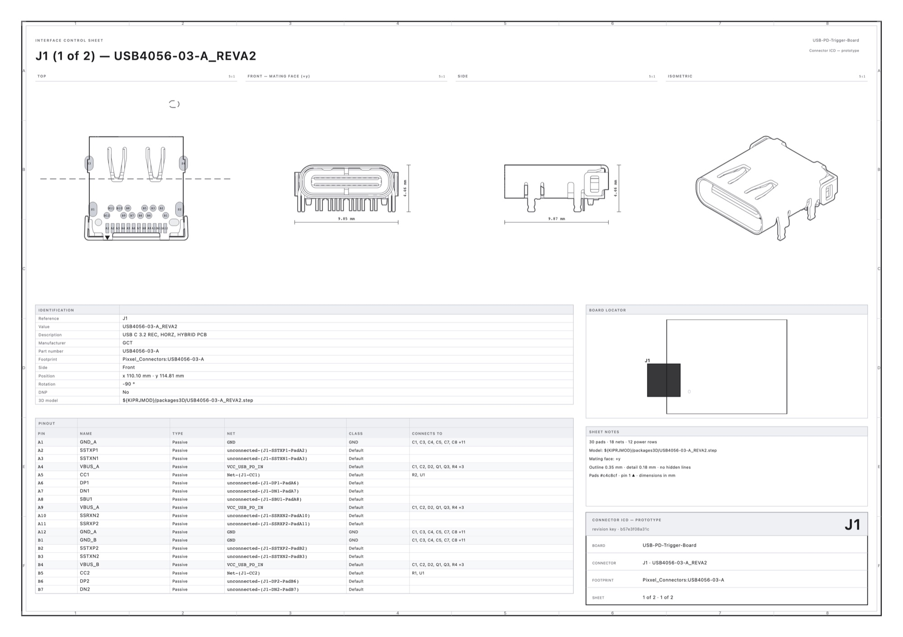

### Also included

- Assets Portal and Workflows for KiCad jobset outputs, and a Documentation
  view for the Markdown kept in a project.
- Design variants with effective BOM and DNP visibility.
- Simulation Studio (experimental, off by default): DC IR drop on a revision's
  board.
- OIDC single sign-on, optional password login, workspace roles, OAuth2 for the
  KiCad panel and scoped service clients for automation.

## Designs shown in the screenshots

The screenshots show publicly available KiCad projects by other designers,
imported into Prism the way a team would import its own. Their schematics,
layouts, 3D models, documentation and design decisions are the work of their
authors. They were not designed, generated or modified by Prism or its
contributors, and they appear here only to show what Prism does with a real
design. All rights stay with the authors under the projects' own terms.

| Project | Author | Source | License |
| --- | --- | --- | --- |
| Cynthion | Great Scott Gadgets | [greatscottgadgets/cynthion-hardware](https://github.com/greatscottgadgets/cynthion-hardware) | CERN-OHL-P v2 |
| WREN (vme-wren, vme-wren-fp-single, EDA-04903, EDA-04949) | CERN, BE-CEM | [be-cem-edl/chronos/wren/wren-hw](https://gitlab.cern.ch/be-cem-edl/chronos/wren/wren-hw) | CERN-OHL-W v2 or later and CC BY-SA 4.0, as stated on the schematic sheets |
| OpenSwitch 10x10G carrier and LAN969x | Quentin Freimanis | [qfreiman/openswitch-10x10g-carrier](https://gitlab.com/qfreiman/openswitch-10x10g-carrier), [qfreiman/openswitch-lan969x](https://gitlab.com/qfreiman/openswitch-lan969x) | No license is stated in the repositories; see them for the author's terms |
| USB-PD-Trigger-Board | Krishna Swaroop (Prism maintainer) | [krishna-swaroop/USB-PD-Trigger-Board](https://github.com/krishna-swaroop/USB-PD-Trigger-Board) | MIT |
| ThunderScope | EEVengers | [EEVengers/ThunderScope](https://github.com/EEVengers/ThunderScope) | MIT |
| Jetson AGX Thor baseboard | Antmicro | [antmicro/jetson-agx-thor-baseboard](https://github.com/antmicro/jetson-agx-thor-baseboard) | Apache-2.0 |

The component catalog in the Library Manager screenshot is CERN's public
KiCad database library. If you are an author of one of these designs and would
like a screenshot changed, credited differently or removed, please
[open an issue](https://github.com/krishna-swaroop/KiCAD-Prism/issues).

## Runtime

| Service | Purpose |
| --- | --- |
| `frontend` | React application and Nginx reverse proxy |
| `backend` | FastAPI, authentication, authorization, and APIs |
| `prism-worker` | project, comparison, visualization, and jobset work |
| `catalog-worker` | catalog import, validation, preview, and release work |
| `postgres` | workspace, comments, catalog, jobs, audit, and session data |

The API and both workers reuse one Prism backend image. Imported repositories
and generated assets live under `data/projects`; Git SSH state lives under
`data/ssh`. PostgreSQL and both directories are required for complete recovery.

See [Architecture](https://krishna-swaroop.github.io/KiCAD-Prism/contribute/architecture/).

## Deploy the latest stable release

Normal users should open the
[latest stable GitHub Release](https://github.com/krishna-swaroop/KiCAD-Prism/releases/latest)
and download its Linux AMD64 deployment archive and checksum.

Each generated bundle contains a pull-only Compose file and exact Prism image
digests:

```bash
sha256sum -c kicad-prism-vX.Y.Z-linux-amd64.tar.gz.sha256
tar -xzf kicad-prism-vX.Y.Z-linux-amd64.tar.gz
cd kicad-prism-vX.Y.Z-linux-amd64
sha256sum -c SHA256SUMS
cp .env.example .env
# Configure authentication, domain, database password, and session secret.
docker compose pull
docker compose up -d --wait
```

The supported public deployment target is Linux AMD64. Native ARM64 release
images are not currently published.

Follow [Deployment](https://krishna-swaroop.github.io/KiCAD-Prism/admin/deployment/) for OIDC, TLS, storage, sizing, and
production checks. If a historical release predates deployment bundles, build
that stable tag from source as documented there.

## First-time setup with the guided installer

For a first deployment from a source checkout, the guided installer can render
the environment and proxy configuration for you instead of requiring every
Compose setting to be assembled by hand. It supports Linux, macOS, WSL2, and
Windows PowerShell, and requires Python 3.9 or newer plus Docker Compose v2.

From the repository root, run the launcher for your platform:

```bash
./deploy.sh
```

```powershell
.\deploy.ps1
```

The installer asks which HTTPS/network scheme applies, collects the required
OIDC and deployment settings, runs preflight and network checks, and writes the
generated configuration under `generated/`. The output includes the environment
file, proxy configuration, Compose overlay, a redacted run record, and a
`NEXT_STEPS.md` checklist. Review the generated files before starting the
services, or let the installer start them after all checks pass:

```bash
./deploy.sh --start
```

Useful first-run modes include:

```bash
./deploy.sh --dry-run                         # render without writing files
./deploy.sh --fresh                           # ignore existing generated config
./deploy.sh --answers answers.json --non-interactive
```

Generated configuration contains deployment secrets and is excluded from Git;
back it up with the rest of the Prism deployment state. The installer is a
guided configuration layer, not a replacement for the [Deployment](https://krishna-swaroop.github.io/KiCAD-Prism/admin/deployment/)
and [Operations](https://krishna-swaroop.github.io/KiCAD-Prism/admin/operations/) guides. For a stable release archive,
follow the pull-only bundle instructions above and use the installer only when
working from a source checkout that includes `deploy.sh` or `deploy.ps1`.

## Develop from source

All feature development and source testing happen through `dev`:

```bash
git clone --branch dev https://github.com/krishna-swaroop/KiCAD-Prism.git
cd KiCAD-Prism
cp .env.example .env
docker compose up --build -d
```

For a private local evaluation, explicitly set `AUTH_ENABLED=false`. Never use
guest administrator mode on a shared or reachable host.

See [Getting started](https://krishna-swaroop.github.io/KiCAD-Prism/get-started/try-it/) and
[Contributing](CONTRIBUTING.md).

## Branch and release model

- Feature, fix, documentation, and refactor branches merge into protected
  `dev` through pull requests.
- `dev` is the integration branch for the next release.
- Tested release scope is merged from `dev` into protected `main`.
- A semantic-version tag on a quality-gated `main` commit builds, smoke-tests,
  and publishes the AMD64 images and deployment bundle.
- Pull requests and ordinary branch pushes never publish container images.

See [Release process](https://krishna-swaroop.github.io/KiCAD-Prism/contribute/release-process/).

## Documentation

- [Documentation index](docs/README.md)
- [Platform overview](https://krishna-swaroop.github.io/KiCAD-Prism/get-started/what-is-prism/)
- [Getting started](https://krishna-swaroop.github.io/KiCAD-Prism/get-started/try-it/)
- [Deployment](https://krishna-swaroop.github.io/KiCAD-Prism/admin/deployment/)
- [Configuration](docs/CONFIGURATION.md)
- [Authentication and access](https://krishna-swaroop.github.io/KiCAD-Prism/admin/authentication/)
- [Project workflows](https://krishna-swaroop.github.io/KiCAD-Prism/use/projects/)
- [Library Manager](https://krishna-swaroop.github.io/KiCAD-Prism/use/library-manager/)
- [Remote Symbol Provider](docs/REMOTE_SYMBOL_PROVIDER.md)
- [Release Studio](docs/release-studio/README.md)
- [Issue trackers](https://krishna-swaroop.github.io/KiCAD-Prism/admin/issue-trackers/)
- [Simulation Studio](https://krishna-swaroop.github.io/KiCAD-Prism/use/simulation-studio/)
- [Team adoption](https://krishna-swaroop.github.io/KiCAD-Prism/get-started/team-adoption/)
- [Operations](https://krishna-swaroop.github.io/KiCAD-Prism/admin/operations/)
- [Upgrades and backups](https://krishna-swaroop.github.io/KiCAD-Prism/admin/upgrades/)
- [Release process](https://krishna-swaroop.github.io/KiCAD-Prism/contribute/release-process/)

## Project status

`main` contains stable release history; the latest release is
[`v5.0.2-alpha`](https://github.com/krishna-swaroop/KiCAD-Prism/releases/tag/v5.0.2-alpha).
`dev` holds unreleased work and may change between releases.

Current boundaries include:

- a single-workspace deployment, not multi-tenant SaaS;
- one role per user rather than composable workspace and catalog permissions;
- mentions are stored but send no email or inbox notifications;
- issue publication covers GitHub and GitLab; Gitea and Forgejo issues, pull
  request status checks and built-in PLM connectors are not shipped;
- fixed workflow types rather than first-class arbitrary workflows;
- no real-time multi-user ECAD editing.

See [Platform overview](https://krishna-swaroop.github.io/KiCAD-Prism/get-started/what-is-prism/) before planning a team rollout.

## Contributing and issues

- [Contributing guidelines](CONTRIBUTING.md)
- [Reporting issues](https://krishna-swaroop.github.io/KiCAD-Prism/contribute/reporting-issues/)
- [Security policy](SECURITY.md)

Changes target protected `dev` through pull requests. The required quality gate
validates frontend, backend, semantic viewer, the native Rust workspace and its
projection parity, source Compose, and release deployment configuration.

## Acknowledgements

Prism builds on work from the KiCad ecosystem, including:

- [ecad-viewer](https://github.com/Huaqiu-Electronics/ecad-viewer)
- [KiCanvas](https://github.com/theacodes/kicanvas)
- [kicad-monkey](https://github.com/wavenumber-eng/kicad_monkey)
- [Interactive HTML BOM](https://github.com/openscopeproject/InteractiveHtmlBom)

## License

KiCAD Prism is licensed under the [Apache License 2.0](LICENSE).
