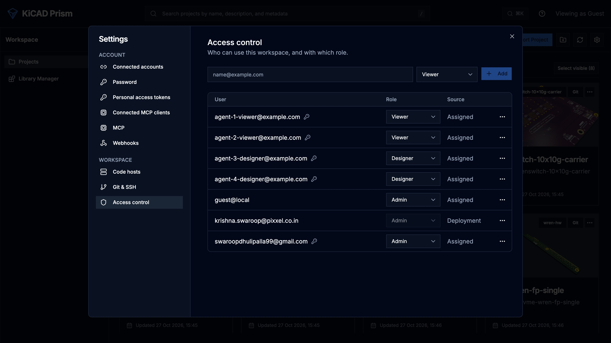

This page sets up how people sign in to Prism and what each of them may do. The
settings themselves are listed under
[Authentication](/KiCAD-Prism/admin/configuration/#authentication).

Prism offers two sign-in methods for people, OIDC and local passwords. You can
turn on either or both. KiCad, scripts and AI assistants use tokens instead,
described at the end of this page.

## Set up OIDC sign-in

1. Register a confidential client for Prism with your identity provider, with
   these two redirect URIs:

   ```text
   https://prism.example.com/auth/callback
   https://prism.example.com/oauth/oidc/callback
   ```

   The first is for the browser. The second is for KiCad's remote symbol panel.
   Replace the host with your `PUBLIC_BASE_URL`. `localhost` and `127.0.0.1`
   count as different addresses, so register the one you actually use.

2. Set the client in the environment file:

   ```env
   AUTH_ENABLED=true
   OIDC_ISSUER_URL=https://sso.example.com/realms/engineering
   OIDC_CLIENT_ID=kicad-prism
   OIDC_CLIENT_SECRET=<client secret>
   OIDC_PROVIDER_NAME=Company SSO
   SESSION_SECRET=<random value, at least 32 characters>
   BOOTSTRAP_ADMIN_USERS_STR=admin@example.com
   PUBLIC_BASE_URL=https://prism.example.com
   CORS_ORIGINS_STR=https://prism.example.com
   ```

3. Recreate the containers:

   ```bash
   docker compose up -d
   ```

4. Sign in with a bootstrap administrator's account.

The issuer must use `https://` and publish standard OIDC discovery metadata.
Prism uses the authorization code flow with PKCE. If your provider needs the
client secret in a Basic header, set `OIDC_TOKEN_AUTH_METHOD=client_secret_basic`.
If it names the email or display name claim differently, set
`OIDC_EMAIL_CLAIM` or `OIDC_NAME_CLAIM`.

## Set up password sign-in

Password sign-in needs no identity provider. It never creates an account: a
person can sign in only once an administrator has given their email a role, and
there is no public sign-up.

1. Turn it on and seed the first administrator:

   ```env
   AUTH_ENABLED=true
   PASSWORD_AUTH_ENABLED=true
   SESSION_SECRET=<random value, at least 32 characters>
   BOOTSTRAP_ADMIN_USERS_STR=admin@example.com
   BOOTSTRAP_ADMIN_PASSWORD=<one-time password, at least 12 characters>
   ```

2. Recreate the containers.
3. Sign in as the administrator. Prism asks you to choose a new password.
4. Remove `BOOTSTRAP_ADMIN_PASSWORD` from the environment file and recreate the
   containers again.

Prism does not overwrite a password that has already been set, so leaving the
seed in place does not reset anything, but it leaves a secret lying around.

People change their own password under **Settings → Password**. Prism sends no
email, so a forgotten password is reset by an administrator: open
**Settings → Access control**, open the row's menu and choose
**Reset password**. The account must change that password at its next sign-in.

## Check the configuration at startup

With sign-in on, Prism refuses to start rather than run half-configured. The
log names the reason, for example a missing `SESSION_SECRET` or an incomplete
OIDC client. The full list is under
[Startup checks](/KiCAD-Prism/admin/configuration/#startup-checks).

## Assign roles

Each person has exactly one role.

| Role | Projects | Comments | Library Manager | Releases |
| --- | --- | --- | --- | --- |
| `viewer` | Open and review | Write, edit their own | Browse | Inspect |
| `qa` | Open and review | Write, edit their own | Browse; QA review | QA sign-off |
| `designer` | Import, sync, organise, run workflows | Write; resolve and publish threads | Create and edit parts | Start builds; designer sign-off |
| `admin` | Everything | Everything, including others' comments | Everything | Everything |

Roles do not combine. A `designer` cannot give the QA sign-off, so independent
release review needs a separate `qa` account.

To give someone a role:

1. Open **Settings → Access control**.
2. Enter their email, pick the role and click **Add**.



Removing someone's role ends all their sessions.

Three settings decide who may sign in before any role is checked:

- `BOOTSTRAP_ADMIN_USERS_STR` names emails that are always `admin`. Use it for
  the first administrators only, and manage everyone else in Prism. Bootstrap
  rows cannot be removed in the UI.
- `DEFAULT_VIEWER_DOMAINS_STR` gives `viewer` to anyone from the listed email
  domains who has no role yet. Leave it empty if every person must be approved.
- `ALLOWED_USERS_STR` and `ALLOWED_DOMAINS_STR` refuse everyone not on the list,
  whatever their role.

Keep at least two administrators.

## Sessions

Prism keeps sessions in PostgreSQL and sends the browser an opaque, signed,
`HttpOnly` cookie. A session lasts `SESSION_TTL_HOURS`, or
`SESSION_REMEMBER_ME_DAYS` when the person ticks **Remember me on this device**
at password sign-in. Set
`SESSION_IDLE_TIMEOUT_MINUTES` to end idle sessions sooner.

Changing `SESSION_SECRET` signs everyone out and invalidates KiCad's provider
tokens.

## Guest mode

```env
AUTH_ENABLED=false
DEV_GUEST_ROLE=viewer
```

Guest mode removes sign-in and treats every request as a guest with
`DEV_GUEST_ROLE`. Use it only for a private trial on one machine or a
deliberately public read-only demo. Prism logs a warning at every start, and
refuses to start in guest mode when `PUBLIC_BASE_URL` is `https://`, or when it
names another host and the guest role is `admin`.

A single person evaluating Release Studio on their own machine needs
`DEV_GUEST_ROLE=admin`, because a `designer` cannot give the QA sign-off.

:::caution
A guest `admin` gives every visitor full control of the workspace. Never use it
where anyone else can reach the port.
:::

`DEV_MODE` does not turn sign-in off.

## Tokens for KiCad, scripts and assistants

| Caller | How it signs in | What it can do |
| --- | --- | --- |
| KiCad's remote symbol panel | Through the browser, against the same Prism sign-in | Read released parts only. Refused everywhere else. |
| Scripts and CI | A personal access token from **Settings → Personal access tokens** | At most what its owner's role allows, limited to the scopes chosen when it was made. |
| AI assistants over MCP | Through the browser, as the person using them | Their user's access, minus release approval, Library QA and administration. Off until you set `PRISM_MCP_ENABLED=true`. |
| Integrations | A service client created through the API by an administrator | The scopes the administrator gave it. |
| Your identity provider's own tokens | `OAUTH_EXTERNAL_JWT_*` settings | The role and scopes in the token's claims. The audience check cannot be turned off. |

A token never holds more than its owner's current role. Personal access tokens
expire after 90 days by default, and never later than `PRISM_PAT_MAX_DAYS`.
People see and revoke the assistants they connected under
**Settings → Connected MCP clients**.

How to create and use each kind is in
[API and tokens](/KiCAD-Prism/automate/api-and-tokens/) and
[MCP](/KiCAD-Prism/automate/mcp/).

## Review access regularly

At least every quarter:

1. Review the bootstrap administrators and the role list.
2. Remove people who have left.
3. Revoke unused service clients and tokens.
4. Check the OIDC redirect URIs, the allowed origins and whether password
   sign-in should still be on.
5. Confirm guest mode is off.
6. Confirm the API port is not reachable directly from the network.
7. Sign in as a `viewer` and check what it can see.
