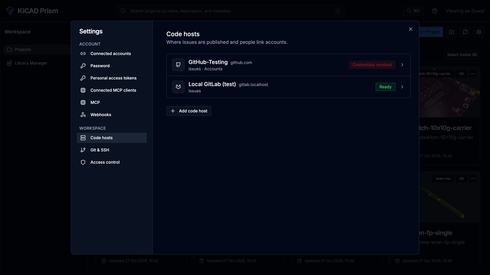

Prism talks to GitHub for three separate jobs, each with its own credential:

| Job | Credential | Where you set it |
| --- | --- | --- |
| Import and sync private repositories | Prism's SSH key, or `GITHUB_TOKEN` | **Settings → Git & SSH**, or the environment file |
| Publish Release Studio releases | `GITHUB_TOKEN` with `contents:write` | The environment file |
| Publish comments as issues | A GitHub App | **Settings → Code hosts** |

Prism never uses `GITHUB_TOKEN` for issues, and never posts to GitHub as a
person.

## Import private repositories

Either add Prism's SSH key to GitHub, as in
[Private Git repositories](/KiCAD-Prism/admin/deployment/#private-git-repositories),
or set a token that can read the repositories:

```env
GITHUB_TOKEN=<token>
```

The token is used only for `https://github.com/` remotes, and is handed to Git
one command at a time rather than stored on disk.

## Publish releases

Release Studio publishes a release as a GitHub Release. The workspace SSH key
can clone but cannot create a Release, so set `GITHUB_TOKEN` to a token with
`contents:write` on the repositories you release from. Without it, Release
Studio refuses to publish and its cover lists only the current release. See
[Release Studio](/KiCAD-Prism/admin/configuration/#release-studio).

## Publish comments as GitHub issues

This sets up a GitHub App so reviewers can publish comments as issues, with
replies and status kept in step both ways. The App posts as its own bot, for
example `prism-acme[bot]`. People can link their own GitHub accounts so issues
credit them by @handle.

### Before you start

- Sign-in is on and you are a Prism administrator.
- `PUBLIC_BASE_URL` is the `https://` address of Prism and GitHub (or your
  GitHub Enterprise Server) can reach it. GitHub sends webhooks and sign-in
  redirects there.
- `TRACKER_CREDENTIAL_ROOT_KEY` is set for both `backend` and `prism-worker`.
  Prism refuses to store GitHub credentials without it. See
  [Issue trackers](/KiCAD-Prism/admin/issue-trackers/#before-you-start).

Below, `https://prism.example.com` stands for your `PUBLIC_BASE_URL`.

### 1. Register the GitHub App

1. Open the registration page for the account that owns the repositories:
   `https://github.com/organizations/<org>/settings/apps/new` for an
   organization, `https://github.com/settings/apps/new` for a personal account,
   or the same path on your GitHub Enterprise Server.
2. Fill in the form:

   | Field | Value |
   | --- | --- |
   | GitHub App name | A name for the bot, for example `Prism Acme`. |
   | Homepage URL | `https://prism.example.com` |
   | Callback URL | `https://prism.example.com/api/trackers/oauth/callback` |
   | Expire user authorization tokens | On |
   | Request user authorization (OAuth) during installation | Off |
   | Enable Device Flow | Off |
   | Webhook → Active | Off for now. You turn it on in step 4. |
   | Repository permissions → Issues | Read and write |
   | Repository permissions → Metadata | Read-only |
   | All other permissions | No access |
   | Where can this GitHub App be installed? | Only on this account |

3. Click **Create GitHub App**.
4. On the App's **General** page, note the **App ID**.
5. Under **Private keys**, generate a private key. GitHub downloads a `.pem`
   file. Keep it for step 3.

### 2. Install the App

1. On the App's page, open **Install App** and click **Install** next to the
   organization or account.
2. Choose **Only select repositories** and pick the repositories whose projects
   will publish issues, plus any separate issues repository.
3. Click **Install**.
4. Note the **Installation ID** at the end of the page's address:

   ```text
   https://github.com/organizations/<org>/settings/installations/12345678
   ```

A project whose repository the App cannot see stays paused until you add the
repository under **Repository access** on this page.

### 3. Add the connection in Prism

1. Open **Settings → Code hosts**, click **Add code host** and choose GitHub.
2. Under **Connection**, name it and choose **github.com** or
   **GitHub Enterprise Server**. For Enterprise Server, also enter the API base
   URL, `https://<host>/api/v3`.
3. Under **GitHub App**, enter the **App ID**, the **Installation ID** and the
   whole contents of the `.pem` file.
4. Click **Create connection**, then **Test connection**.



A successful test shows that the connection publishes as `<app>[bot]`, and the
code host shows **Ready**. Prism writes to GitHub only after a successful test.

| The test fails with | Fix |
| --- | --- |
| An authentication error | The App ID and key belong to different Apps, or the key was deleted. Generate a new key and paste it. |
| Not found | The Installation ID is wrong, or the App was uninstalled. |
| Permissions | The App lacks **Issues: Read and write**. Change it under **Permissions & events** and accept the new permissions on the installation page. |
| A network error | The server cannot reach `api.github.com` or your Enterprise Server over HTTPS. |

### 4. Turn on the webhook

Without a webhook, Prism polls GitHub every few minutes. With it, changes on
GitHub reach Prism within seconds.

1. Generate a secret:

   ```bash
   openssl rand -hex 32
   ```

2. In Prism, under **Webhook**, paste the secret into **Webhook secret**, copy
   the **Webhook URL** and click **Save changes**.
3. On GitHub, open the App's **General** page. Under **Webhook**, tick
   **Active**, paste the URL and the same secret, and save.
4. Open **Permissions & events**. Under **Subscribe to events**, tick **Issues**
   and **Issue comment**, and save.
5. Under **Advanced → Recent Deliveries**, check that the `ping` delivery shows
   `200`.

Save the secret in Prism first. GitHub sends `ping` at once, and Prism answers
`401` until it knows the secret.

| Delivery result | Fix |
| --- | --- |
| `401` | The secrets differ. Paste the same value in both places. |
| Connection failed or timed out | GitHub cannot reach `PUBLIC_BASE_URL`. |
| `404` | The URL belongs to another connection. |

### 5. Let people link their accounts

Linking only reads the person's GitHub username.

1. On the App's **General** page, note the **Client ID** and generate a client
   secret.
2. In Prism, expand **Account linking**. Check that **Callback URL** matches
   the App's callback URL, paste the **OAuth Client ID** and
   **OAuth Client Secret**, and click **Save changes**.
3. Each person opens **Settings → Connected accounts** and clicks **Connect**
   next to GitHub.

If GitHub says the redirect URI is not associated with the application, the
two callback URLs differ. They must match exactly.

### 6. Turn on publishing for a project

1. Open the project and click **Issue publishing** in its header.
2. Choose GitHub Issues and, if you have several, the connection.
3. Choose the repository: the project's own, or another the App is installed on.
4. Set the rules for what publishes automatically and who may publish the rest.
5. Click **Save**.

A public repository stays paused until an administrator clicks
**Allow public issues**. Changing the repository asks again.

### Check the round trip

1. Publish a comment in Prism. An issue appears on GitHub from the App's bot.
2. Reply on GitHub. The reply appears in Prism.
3. Reply in Prism. The reply appears on GitHub.
4. Close the issue on GitHub. The thread shows as closed in Prism.

If replies take minutes to arrive, the webhook is not delivering. Recheck step 4.

Running the connection day to day is covered in
[Issue trackers](/KiCAD-Prism/admin/issue-trackers/).
