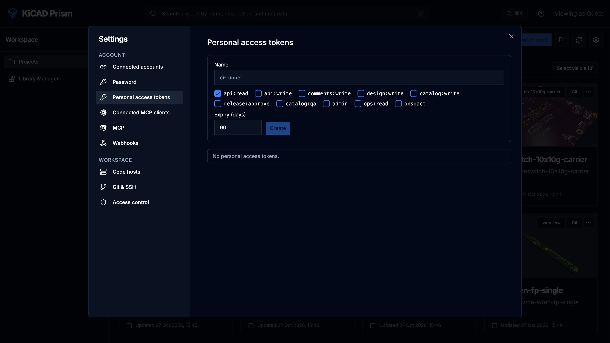

Create a personal access token, then call any Prism route under `/api/v1` from any language. Everything the web app does goes through this API.

## Create a personal access token

1. Sign in to Prism in the browser.
2. Open **Settings → Personal access tokens**.
3. Enter a **Token name** (1 to 80 characters).
4. Tick the scopes the script needs. See [Scopes](#scopes).
5. Set **Expiry (days)**. The administrator sets the longest allowed expiry.
6. Click **Create**.
7. Copy the token with **Copy token**. It starts with `prism_pat_` and is shown only once.



:::caution
Store the token like a password, for example as a CI secret. Anyone holding it acts as you, with the scopes it carries.
:::

A token can only be created from a signed-in browser session; a token can't create another token. Tokens aren't available while authentication is off.

The list under the form shows each of your tokens with its name, prefix, scopes, expiry and last use. Click **Revoke** on a row to stop the token at once. The page shows only your own tokens. An administrator lists everyone's with `GET /api/v1/auth/tokens/all` and can revoke any of them with `DELETE /api/v1/auth/tokens/{token_id}`.

## Scopes

A token's scopes limit what it may do. Its owner's role limits it further: a token never does more than its owner could do in the browser right now.

| Scope | Allows |
| --- | --- |
| `api:read` | every read the owner can make |
| `comments:write` | add comments and replies |
| `design:write` | project and design changes that need the designer role, such as syncing a project or queuing a release build |
| `catalog:write` | catalog edits, such as creating a component draft |
| `release:approve` | approving and publishing releases |
| `catalog:qa` | catalog QA decisions |
| `admin` | administrator changes |
| `api:write` | every scope from `comments:write` to `admin` above |
| `ops:read` | the [ops diagnostics](/KiCAD-Prism/automate/ops-diagnostics/) reads |
| `ops:act` | the ops actions, and everything `ops:read` allows |

Every write scope also grants `api:read`. `api:write` never grants `ops:read` or `ops:act`. Only an administrator can create a token with an ops scope.

No token resolves or reopens a comment thread, whatever its scopes.

## Call the API

- The base path is `/api/v1`. The unversioned `/api` paths still work, but use `/api/v1` in new scripts.
- The OpenAPI document is at `/api/v1/openapi.json`. Every operation has a stable `operationId` and a typed response.
- Send the token as `Authorization: Bearer <token>`.
- An error is a JSON object `{"detail": "...", "code": "..."}`.

```bash
curl -H "Authorization: Bearer $PRISM_TOKEN" "https://prism.example.com/api/v1/projects/search?q=power"
```

## Retry a write safely

Send an `Idempotency-Key` header on a `POST`, `PUT`, `PATCH` or `DELETE`. Use a fresh value, such as a UUID, for each new write, and the same value when you retry it.

- Repeating the request with the same key within 24 hours returns the first response, with the header `Idempotent-Replayed: true`. The work isn't done twice.
- Reusing a key on the same route with a different query or body is refused with the code `idempotency-key-reused`.
- A retry that arrives while the first request is still running gets a conflict with the code `idempotency-key-in-progress`. Wait and retry.
- A key is 1 to 255 printable ASCII characters.
- A response with a 5xx status isn't stored, so a retry runs the request again.

```bash
curl -X POST \
  -H "Authorization: Bearer $PRISM_TOKEN" \
  -H "Idempotency-Key: 7f9c2e64-5d1b-4f0e-9a51-3c6b2f1d8e40" \
  https://prism.example.com/api/v1/projects/my-board/sync
```

The [Python SDK](/KiCAD-Prism/automate/sdk-and-cli/) adds a fresh key to every write for you.

## Pin a revision

Design reads take a revision, so a script reads one commit even while the branch moves:

| Read | Route | Parameter |
| --- | --- | --- |
| Search components and nets | `GET /api/v1/projects/{project_id}/design/search` | `revision` |
| One component | `GET /api/v1/projects/{project_id}/design/components/{ref}` | `revision` |
| One net | `GET /api/v1/projects/{project_id}/design/nets/{name}` | `revision` |
| Engineering BOM | `GET /api/v1/projects/{project_id}/bom` | `commit` |

The value is a commit, branch or tag. Left out, Prism reads the project's current head. The response names the full commit it read, so later calls can pin to it.

## Follow long work

Comparisons, project syncs, design-data builds, release builds and imports run as jobs. The route that starts one returns a job id.

1. Start the work and keep the `job_id` from the response.
2. Poll `GET /api/v1/jobs/{job_id}` every few seconds.
3. Stop when `status` is `completed`, `failed` or `cancelled`.

## Read the event log

`GET /api/v1/events?after=<cursor>` lists what happened, oldest first: project syncs, design-data builds, job progress, finished comparisons, comment changes and release candidates. Each event has an `id`, a `kind`, a `topic`, a `projectId`, a `createdAt` time and a `payload`.

| Parameter | Meaning |
| --- | --- |
| `after` | return events after this id; start at `0` |
| `topic` | only these topics; repeat it for several. Most events use `project:<project id>`; a finished comparison uses `job:<job id>`. |
| `limit` | events per page, up to 500 |

The response is `{"events": [...], "next": <cursor>}`. Pass `next` as `after` on the next call. You only see events for projects you can see.

The WebSocket `/api/v1/events/live` pushes the same events as they happen. After connecting, send a subscribe frame:

```json
{"type": "subscribe", "after": 0, "topics": ["project:my-board"]}
```

Prism answers with `{"type": "events", "events": [...], "next": <cursor>}` frames. Keep the last `next` and send it as `after` when you reconnect.

Events are kept for a limited time, set by the administrator. See [Configuration](/KiCAD-Prism/admin/configuration/#automation-and-mcp). To have Prism push events to your service instead, use [Webhooks](/KiCAD-Prism/automate/webhooks/).

## Request ids

Every response carries an `X-Request-Id` header. You may send your own: 1 to 64 letters, digits, `.`, `_` or `-`. Quote it when you report a problem; an administrator can trace it with the [ops diagnostics](/KiCAD-Prism/automate/ops-diagnostics/).

## Audit

Every write made with a token is recorded with the user, token and route. Administrators see these rows under **Settings → MCP**, in **Audit**.
