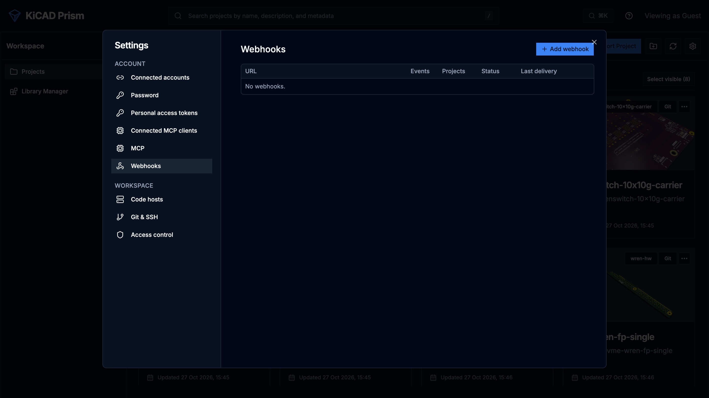

A webhook posts one signed JSON request to your service for each event you choose, in order. Use it to start a pipeline when a comparison finishes, post to chat when a comment changes, or record each release build.

## Before you start

- You need the administrator role.
- `TRACKER_CREDENTIAL_ROOT_KEY` must be set on the server: webhook signing secrets are encrypted with it. See [Configuration](/KiCAD-Prism/admin/configuration/#automation-and-mcp).
- The receiver must be an `https` URL on a public address. Prism refuses `http`, private, loopback and link-local addresses, both when you save and before every delivery. To test against a receiver on your own machine, an administrator can set `PRISM_WEBHOOK_ALLOW_PRIVATE=true`.

## Add a webhook

1. Open **Settings → Webhooks**.
2. Click **Add webhook**.
3. Enter the receiver's **URL**.
4. Under **Event kinds**, tick the events to send.
5. Under **Projects**, choose **All projects** or **Listed projects** and pick the projects.
6. Click **Create**.
7. Copy the signing secret with **Copy secret**. It starts with `whsec_` and is shown only this once.
8. Click **Test** on the webhook's row. Prism sends a `ping` event and shows the result.



## Events

| Event | Sent when |
| --- | --- |
| `revision.synced` | a project fetched new commits from its remote |
| `bundle.built`, `bundle.failed` | a revision's design data finished building, or failed |
| `job.progress`, `job.finished` | a job moved forward or ended |
| `comparison.done` | a design comparison finished |
| `comment.changed` | a comment or reply was added, edited or resolved |
| `release.candidate_built`, `release.approved` | a Release Studio candidate built, or a person approved it |

## What Prism sends

Each delivery is a `POST` with a compact JSON body:

```json
{"id": 4182, "type": "comparison.done", "createdAt": "2026-10-26T12:00:00Z", "projectId": "my-board", "data": {"jobId": "...", "base": "...", "compare": "..."}}
```

- `id` is the event's id in the event log, and increases with every event.
- `data` depends on the event. For example, `comment.changed` carries `commentId` and `changeKind`.
- The `ping` from **Test** has `"type": "ping"`, `"projectId": null` and empty `data`.

Answer with any 2xx status to accept the delivery. Prism waits up to 10 seconds for an answer.

## Verify the signature

Deliveries follow [Standard Webhooks](https://www.standardwebhooks.com/). Each carries three headers:

| Header | Value |
| --- | --- |
| `webhook-id` | the event id |
| `webhook-timestamp` | the send time, in Unix seconds |
| `webhook-signature` | `v1,` and the base64 HMAC-SHA256 of `<webhook-id>.<webhook-timestamp>.<body>` |

The HMAC key is the secret after its `whsec_` prefix, base64-decoded. Check the signature against the raw body bytes, before you parse the JSON, and reject a timestamp that is more than a few minutes old.

The repository's `examples/webhooks/verify_prism_webhook.py` does this with the standard library only. Its `verify(secret, headers, body)` returns the parsed event, or raises `ValueError` when the delivery isn't authentic or is too old.

## Example: a receiver

Run the example as a receiver on your machine:

1. Copy `examples/webhooks/verify_prism_webhook.py` from the Prism repository.
2. Set the webhook's secret:

   ```bash
   export PRISM_WEBHOOK_SECRET=whsec_...
   ```

3. Start it:

   ```bash
   python verify_prism_webhook.py
   ```

It listens on `127.0.0.1:8080` (set `PRISM_WEBHOOK_PORT` to change the port), prints each accepted event and answers 400 to a delivery that fails verification. Expose it through a public HTTPS tunnel or reverse proxy, or use `PRISM_WEBHOOK_ALLOW_PRIVATE` on a test server.

To act on events, import `verify` into your own receiver. This one uses the [Python SDK](/KiCAD-Prism/automate/sdk-and-cli/) to fetch a finished comparison's schematic review and print its groups:

```python
import json
import os
from http.server import BaseHTTPRequestHandler, HTTPServer

from prism import Client
from verify_prism_webhook import verify

SECRET = os.environ["PRISM_WEBHOOK_SECRET"]
prism = Client()  # PRISM_URL and PRISM_TOKEN


class Receiver(BaseHTTPRequestHandler):
    def do_POST(self):
        body = self.rfile.read(int(self.headers.get("content-length") or 0))
        try:
            event = verify(SECRET, self.headers, body)
        except ValueError:
            self.send_response(400)
            self.end_headers()
            return
        self.send_response(204)
        self.end_headers()

        if event["type"] == "comparison.done":
            job_id = event["data"]["jobId"]
            review = prism.get_comparison_review(event["projectId"], job_id, domain="sch")
            for group in review["groups"]:
                print(json.dumps({"impact": group["impact"], "title": group["title"]}))


HTTPServer(("127.0.0.1", 8080), Receiver).serve_forever()
```

The receiver answers before it does any slow work, so Prism isn't kept waiting.

## Retries and failures

Prism delivers each webhook's events in order, one at a time. When a delivery fails:

- Prism stops that webhook and retries the same event after 30 seconds, then after twice as long each time, up to once an hour.
- Later events wait, in order, until it succeeds. Events wait only as long as the event log keeps them, which the administrator sets in [Configuration](/KiCAD-Prism/admin/configuration/#automation-and-mcp).
- After 24 hours of failures the webhook's status becomes `failing` and Prism stops trying. Fix the receiver, then click **Enable** on the row to resume from where it stopped.

Because a retry resends an event your receiver may already have handled, use the `webhook-id` header to ignore repeats.

## Manage webhooks

Each row under **Settings → Webhooks** shows the URL, events, projects, status (`active`, `failing` or `disabled`) and last delivery. Its buttons:

| Button | Does |
| --- | --- |
| **Deliveries** | lists the latest delivery attempts with their time, event, status and duration |
| **Test** | sends a `ping` |
| **Rotate secret** | makes a new signing secret and shows it once; the old one stops working |
| **Disable** / **Enable** | pauses or resumes deliveries |
| **Edit** | changes the URL, events or projects |
| **Delete** | removes the webhook |

Delivery records are kept for 30 days. To check webhook lag from a script, use `get_event_and_webhook_health` in [Ops diagnostics](/KiCAD-Prism/automate/ops-diagnostics/).
