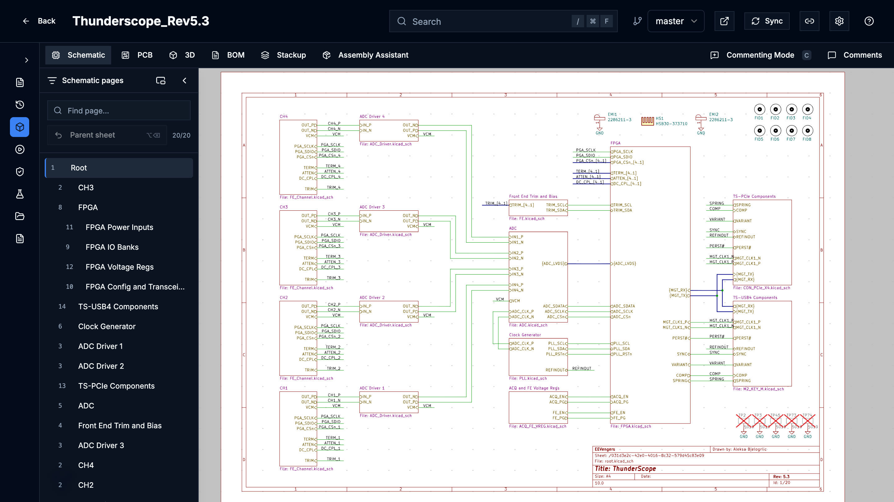
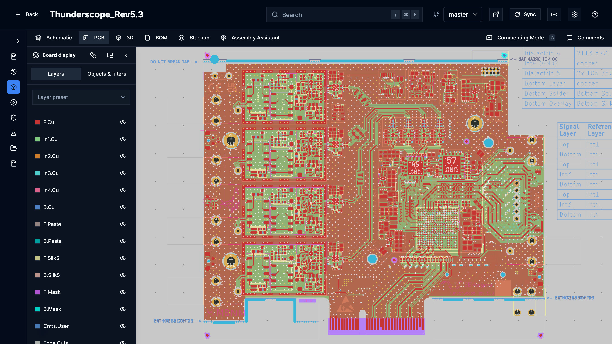
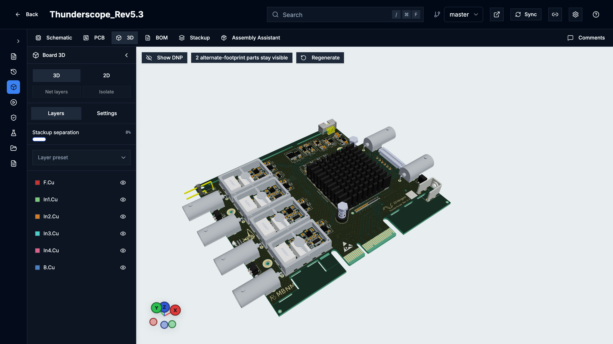
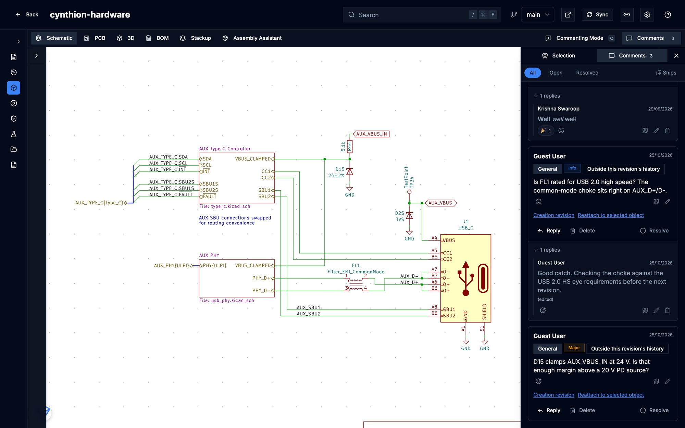
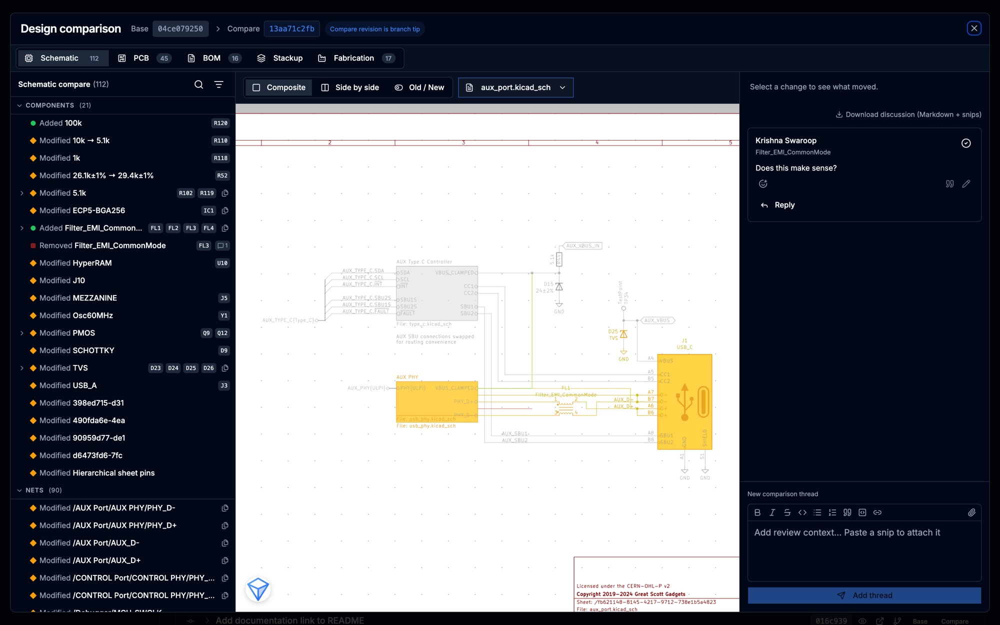
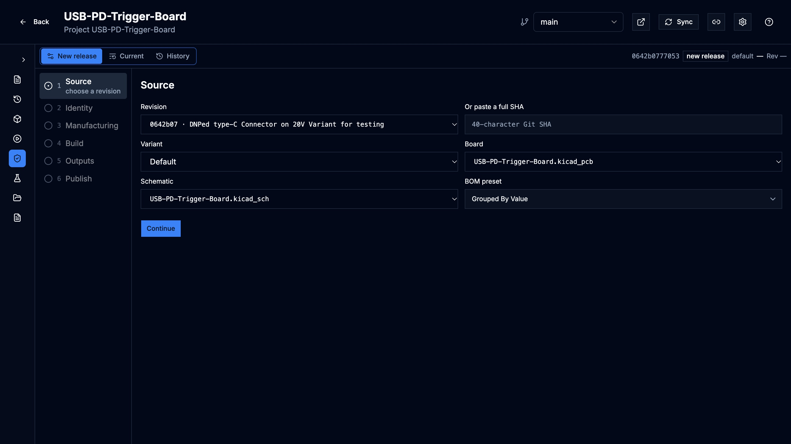
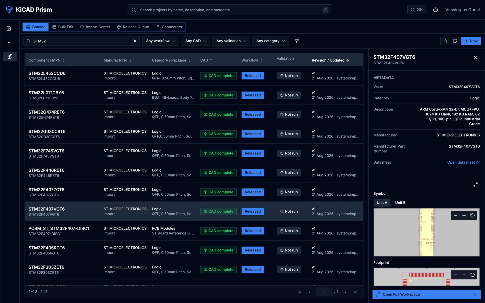

KiCAD Prism is an open-source, self-hosted platform for teams that design in
KiCad and keep their projects in Git. KiCad stays the editor and Git stays the
source of truth. Prism adds what happens around them: browsing any revision in
the browser, reviewing changes with comments, building and signing off release
packages, and running a component library that desktop KiCad places parts from.

It runs on your own hardware. No design data leaves your network unless you
publish it.

## Browse and review any revision

Import a project from any SSH or HTTPS Git remote, including repositories that
hold several boards. Every branch, commit and tag opens in schematic, PCB, 3D,
BOM and stackup views, with cross-probing between them.

| Schematic | PCB | 3D |
| --- | --- | --- |
|  |  |  |

- **Insets** open a live view of the other document from any pin or pad, and
  chain from there.
- **Net highlighting** follows one net across schematic, PCB and 3D, with its
  routed length, layers, tracks and vias. In 3D you can isolate a net to see
  only its copper.
- **Comments** anchor to a sheet, part or area on the revision they were
  written on. They take rich text, pasted snips and attachments, update live
  for everyone viewing, and can be published as GitHub or GitLab issues.

Prism reads each revision once, in the background, with its own KiCad parser,
and keeps the result as the revision's design data. The newest commits on each
branch and every tag are prepared ahead of time, so they open without waiting.
See [Design data](/KiCAD-Prism/use/design-data/).

## Compare revisions

Design Comparison lists what changed between any two revisions in the
schematic, PCB, BOM, stackup and fabrication outputs, highlights each change on
the sheet, and keeps the review discussion beside it.

See [Compare two revisions](/KiCAD-Prism/use/design-comparison/).

## Release a board

Release Studio takes a committed revision through source, identity,
manufacturing, build, outputs and publish. It builds fabrication and assembly
files, PDF documents and manufacturer packs, shows the Gerbers in the browser,
records DRC and ERC evidence with a designer and a QA sign-off, and publishes
the approved package to GitHub or GitLab Releases.

See [Release Studio](/KiCAD-Prism/use/release-studio/).

## Govern components

Library Manager is a component catalog with immutable revisions, reusable
symbol, footprint, 3D and SPICE assets, optional KiCad Library Convention
checks and a QA release flow. You can import components from library folders
or from the parts your projects already use.

Released parts reach desktop KiCad through the Remote Symbol Provider, which
places the exact catalog revision with its 3D models embedded, or through a
generated KiCad database library.

See [Library Manager](/KiCAD-Prism/use/library-manager/) and
[Place parts in desktop KiCad](/KiCAD-Prism/use/remote-symbols/).

## Automate it

Everything a person can do in the browser, short of a sign-off, a script can do
too:

- an HTTP API with an OpenAPI document, authenticated with personal access
  tokens;
- a Python SDK and a `prism` command-line tool;
- an MCP server, so an AI assistant can read designs, leave comments and start
  jobs as the signed-in user;
- outbound webhooks, and CI templates that review every pull request.

Tokens act with their owner's role and cannot approve releases, resolve
comments or perform catalog QA. See
[Automation overview](/KiCAD-Prism/automate/overview/).

## Also included

- **Workflows** and the **Assets Portal** run the project's KiCad jobset and
  keep its outputs. A **Documentation** tab shows the Markdown kept in the
  project.
- Design variants, with the effective BOM and DNP parts for each.
- Sign-in with OIDC single sign-on or local passwords, and four roles:
  viewer, designer, QA and admin.
- Simulation Studio (experimental, off by default): DC IR drop on a revision's
  board.

## What Prism does not do

- Prism is not an editor. You change designs in KiCad and push them to Git;
  Prism never edits your design files.
- It has no real-time multi-user editing.
- One installation is one workspace. It is not a multi-tenant service.
- A user has exactly one role. You cannot combine, for example, designer and
  QA on one account.
- Mentions in comments are recorded but send no email or inbox notification.
- Issue publication covers GitHub and GitLab. Gitea and Forgejo can be linked
  as accounts, but issues are not published to them.
- Prism does not hold a pull request's approved or changes-requested state.
  Keep the final approval in your Git host or change-management system.

## How it runs

Prism is a set of Docker containers: a web frontend, an API server, two
background workers and PostgreSQL. Your imported repositories, generated files
and Prism's Git SSH key live in two directories next to the Compose file. The
published images are for Linux on AMD64.

See [Concepts](/KiCAD-Prism/get-started/concepts/) for how the pieces fit
together, and [Deployment](/KiCAD-Prism/admin/deployment/) for a shared
installation.

## Next steps

- [Try it on your machine](/KiCAD-Prism/get-started/try-it/).
- [Roll it out to a team](/KiCAD-Prism/get-started/team-adoption/).
