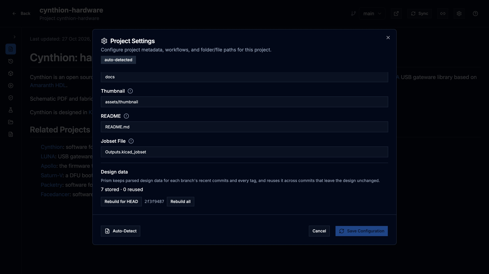

Prism reads each revision of a project once, in the background, and keeps the
result as that revision's design data. The project card, the viewers, the 3D
tab, the BOM, variants, Design Comparison, library imports and Release Studio
all use it. This page explains the messages you see while it is built and how
to rebuild it.

## Design data is prepared ahead

After an import or a sync, Prism prepares design data for the newest commits
of each branch and for every tagged commit, before anyone opens them. A commit
that leaves the design files unchanged reuses the previous commit's design
data instead of being read again.

Older commits are prepared the first time someone opens them.

## "Preparing design data…"

A view that opens a revision without design data shows **Preparing design
data…** while it is built, then fills in by itself.

- A large board can take a few minutes the first time, most of it spent by
  KiCad refilling the copper zones. Later opens are immediate.
- The 3D tab fills in stages: the bare board can appear before its parts.
- If the view stops waiting, it offers **Check again**.

You don't need to stay on the page; the build continues on the server.

## "Design data could not be built"

When reading a revision fails, the view shows **Design data could not be
built** with the error from KiCad or Prism, and a **Retry** button.

1. Read the error. It usually names the file and the problem.
2. If the cause was temporary, select **Retry**.
3. If KiCad cannot read a file, fix it in the repository, push, and sync the
   project. The failed revision stays failed until it is fixed or retried.

Without a retry, Prism tries a failed revision again the first time it is
opened after an hour. Your administrator can change that interval; see
[Configuration](/KiCAD-Prism/admin/configuration/).

## "Local changes are not shown"

Design data is always built from a commit. If Prism's own copy of the
repository has uncommitted changes, the view notes **Local changes are not
shown**: what you see is the last commit, not the changed files.

## Check a project's design data

1. Open the project.
2. Select the gear icon (**Project settings**) in the project header.
3. Scroll to **Design data**.

The summary line counts the revisions that are stored, reused from another
commit, building, failed or incomplete. Below it, Prism lists the most recent
revisions with a failed or partial stage, and the most recent failed builds,
each with its commit and the reason. Hover a reason to read it in full.

Project Settings is available to designers and admins.

## Rebuild design data

In **Design data**:

- **Rebuild for HEAD** drops and rebuilds the design data of the commit Prism
  has checked out. Its short hash is shown next to the button.
- **Rebuild all** drops every revision's design data for the project and
  rebuilds it from scratch. Confirm with **Rebuild all** in the dialog. Until
  the rebuilds finish, views can be slower or show **Preparing design
  data…**.

A rebuild cannot start while another build of the project is running; Prism
says so and you can try again when it finishes.

Rebuild when a revision looks wrong and a retry did not help.
