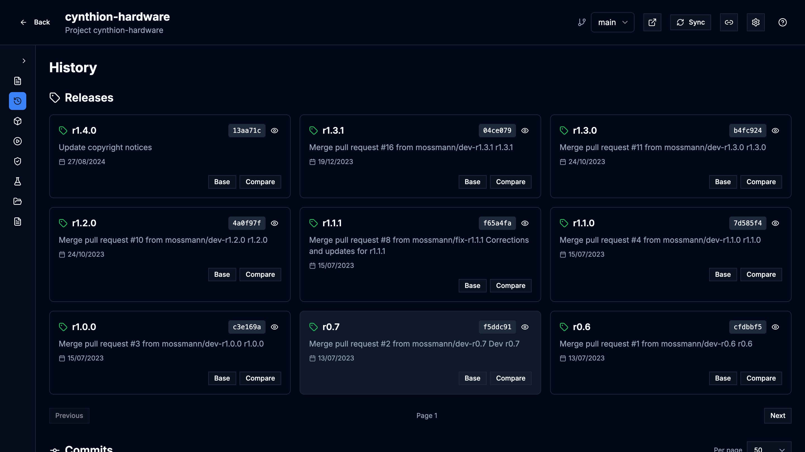
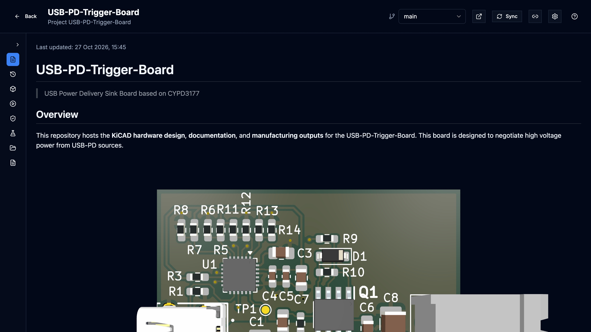
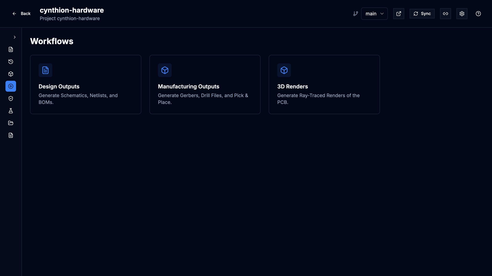
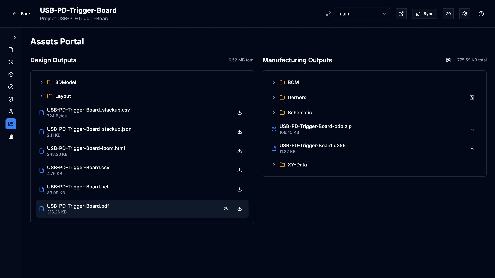
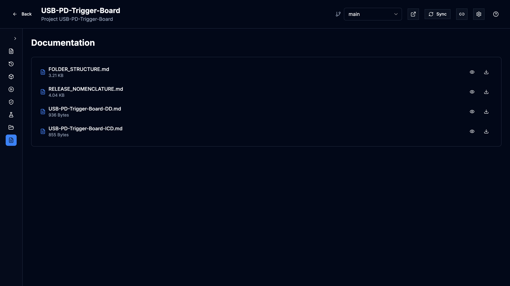

This page shows how to bring a KiCad project from a Git repository into Prism,
keep it up to date with the remote, arrange projects in folders, and adjust
what Prism detected about each one.

Importing, syncing, moving and deleting projects, and editing project
settings, need the designer or admin role. Viewers can open and browse every
project they have access to.


## Import a project

Prism reads projects from Git. You cannot upload files or edit a board in
Prism: engineers keep working in their own clones and push to the remote as
usual, and Prism follows the remote.

1. In the workspace, select **Import Project**.
2. In **Repository**, enter the clone URL, either HTTPS
   (`https://github.com/org/repo.git`) or SSH (`git@host:org/repo.git`).
3. Select **Analyze**. Prism queues a job that reads the repository and looks
   for KiCad projects. The dialog shows each step while it runs.
4. Pick the branch to import in **Branch**. Changing it analyzes that branch
   again, since another branch can hold different boards.
5. If the repository holds several KiCad projects, tick the ones you want, or
   use **Select All**. Projects already in the workspace are marked
   **Imported**.
6. Select **Import**. When the import finishes, the dialog shows **Import
   Complete** and the projects appear in the workspace.

A repository can hold any number of KiCad projects; each one you select
becomes its own Prism project. Importing a repository that is already in the
workspace lets you add the projects you skipped the first time.

Prism refuses local file paths, URLs with a username or password written into
them, and unusual Git transport protocols.

<video autoplay loop muted playsinline poster="/KiCAD-Prism/media/project-import-poster.jpg">
  <source src="/KiCAD-Prism/media/project-import.webm" type="video/webm" />
  <source src="/KiCAD-Prism/media/project-import.mp4" type="video/mp4" />
</video>

### Import a private repository

If the analysis cannot reach the repository, the dialog shows **Grant Prism
access** with the steps for that host:

- **SSH.** Copy **Prism's public key** and add it to the repository as a
  read-only deploy key. For GitHub and GitLab the dialog links straight to the
  deploy key settings. Then select **Try again**.
- **No key yet.** If the dialog says the workspace has no SSH key, or that the
  host is not trusted yet, an administrator has to create the key or add the
  host key under **Settings → Git & SSH** first.
- **HTTPS.** Private HTTPS remotes use the token the administrator configured
  for that host.

Administrators set up host access as described in
[GitHub](/KiCAD-Prism/admin/github/) and [GitLab](/KiCAD-Prism/admin/gitlab/).

### Lay out the repository for detection

Prism finds the schematic, board, jobset, README and thumbnail on its own in
most repositories. A predictable layout keeps detection reliable:

```text
project/
├── board.kicad_pro
├── board.kicad_sch
├── board.kicad_pcb
├── Outputs.kicad_jobset
├── README.md
└── docs/
```

Keep generated manufacturing files out of the design folder where you can.
If your layout differs, set the paths in [Project Settings](#change-project-settings)
instead of restructuring the repository.

## Keep a project in sync

Prism fetches every imported repository in the background, every five minutes
by default (your administrator can change or turn off the interval, see
[Configuration](/KiCAD-Prism/admin/configuration/)). An open project page
notices a newer commit on the branch you are viewing and offers **New revision
available · View**.

To fetch immediately:

1. Open the project.
2. Select **Sync** in the project header.

A notification tracks the sync and reports when it completes or why it failed.
Sync fetches the remote and moves Prism's checkout forward when that can be
done safely.

### View another branch or commit

- **Branch.** The branch menu in the project header lists each branch of the
  remote once. Pick one to view its latest fetched commit.
- **Commit.** In **History**, select the eye icon (**Open this commit in the
  visualizer**) on any commit, or select a release.

While you view anything other than the current checkout, a banner names the
branch or commit (for a commit, also how many commits it is behind) and
offers **Return to Branch Head** or **Return to Current Checkout**.



To share a view of one exact revision, copy the link while a commit is open:
the URL carries the commit, so it keeps pointing at the same design after new
pushes. See [Links to a view](/KiCAD-Prism/automate/view-links/) for what a
link can hold.

## Find your way around a project

The project sidebar has these sections:

| Section | What it holds |
| --- | --- |
| **Overview** | The project's README |
| **History** | Releases (tags) and commits, with the files each commit changed, and the entry point to [Design Comparison](/KiCAD-Prism/use/design-comparison/) |
| **Visualizers** | Schematic, PCB, 3D, BOM, Stackup and Assembly Assistant; see [View a design](/KiCAD-Prism/use/viewing-designs/) |
| **Workflows** | The **Design Outputs**, **Manufacturing Outputs** and **3D Renders** jobs, run from the project's KiCad jobset, with their live log |
| **Release Studio** | Builds and sign-off of a release; see [Release Studio](/KiCAD-Prism/use/release-studio/) |
| **Assets Portal** | Files the workflow jobs produced |
| **Documentation** | Markdown and other documents from the project's documentation folder |

<video autoplay loop muted playsinline poster="/KiCAD-Prism/media/project-tour-poster.jpg">
  <source src="/KiCAD-Prism/media/project-tour.webm" type="video/webm" />
  <source src="/KiCAD-Prism/media/project-tour.mp4" type="video/mp4" />
</video>









In **History**, expand a commit to see its changed files. Selecting a file
does one of three things:

- A schematic, board, project, symbol or footprint file opens in the
  Visualizers at that commit.
- A PDF, CSV, text or Markdown file opens in a new browser tab, served from
  that commit.
- Any other file, such as a Gerber, is listed only.

## Organize projects in folders

The workspace shows folders and projects in **Gallery** or **List** view, and
the search box at the top searches projects by name, description and
metadata.

- **Create a folder.** Select the folder icon (**Create new folder**) next to
  **Import Project**. The folder is created at the level you are viewing.
- **Rename or delete a folder.** Open the folder's **⋯** menu and choose
  **Rename** or **Delete Folder**. Deleting a folder also deletes the folders
  inside it and moves their projects to the workspace root.
- **Move a project.** Open the project card's **⋯** menu, choose **Move to
  Folder**, and pick the destination, or **Workspace Root**.
- **Inspect a project.** Click a project card once to open its properties
  panel: repository link, latest commit and tag, board size and thickness,
  file formats and dates. Double-click to open the project.
- **Change the thumbnail.** In the properties panel, use **Upload image**,
  **Use rendered board** or **Re-render**. **Regenerate Thumbnail** in the
  card's **⋯** menu renders the board again.

Delete and other destructive actions ask you to press and hold the button; a
single click does nothing.

### Delete a project

1. Open the project card's **⋯** menu.
2. Choose **Delete Project**.
3. Press and hold **Hold to delete**.

Deleting removes the project from Prism and deletes Prism's copy of its files.
The Git remote is not touched. A designer cannot delete a project that has
signed releases; an administrator can.

## Change project settings

Project Settings overrides what Prism detected: the display name, the
description and the file paths.

1. Open the project.
2. Select the gear icon (**Project settings**) in the project header.
3. Change the fields you need:
   - **Project Name** and **Project Description**, shown in the workspace and
     used by search.
   - **Workflows (JSON Array)**, the definitions behind the Workflows section.
   - **Schematic**, **PCB**, **Subsheets Folder**, **Design Outputs**,
     **Manufacturing Outputs**, **Documentation**, **Thumbnail**, **README**
     and **Jobset File**. Each field shows the path Prism resolved under
     **Resolved:**.
4. Select **Save Configuration**.

**Auto-Detect** runs detection again and fills in what it finds, without
saving. The badge under the title says whether the project uses
**auto-detected** paths or **explicit** settings.

Prism stores these settings in its own database and never writes them into
the repository. A `.prism.json` file committed in the repository also sets
them; when both exist, the values saved in Project Settings win.

The **Design data** block at the bottom of Project Settings shows the state of
the design data Prism keeps for each revision. See
[Design data](/KiCAD-Prism/use/design-data/).

## Open a project in desktop KiCad

The external-link icon in the project header (**Open in KiCad**) opens the
project in desktop KiCad on your computer. It needs the Prism agent installed
on that computer; without it, the button does nothing.
